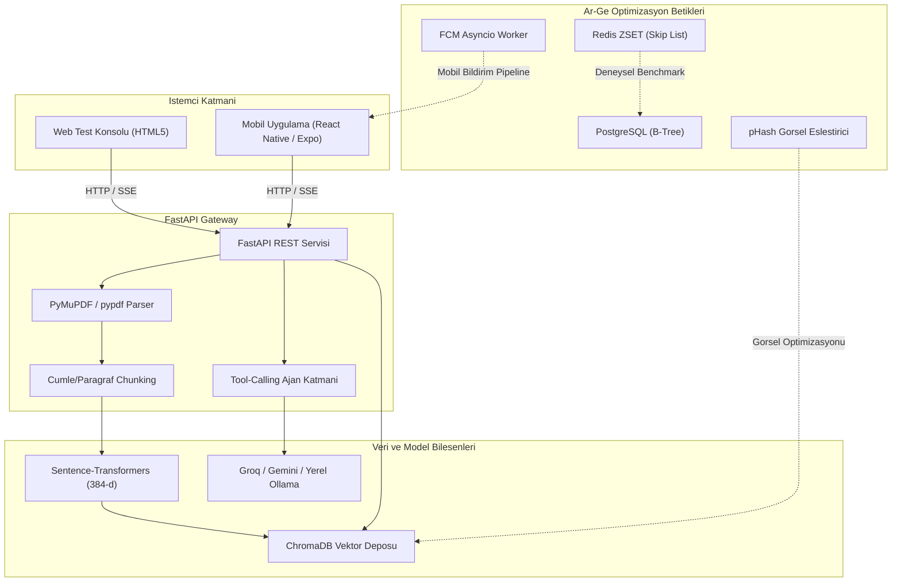

# Ar-Ge Staj Projeleri ve Sistem Mimarisi Raporu

**Ogrenci:** Yusuf Can Goren  
**Alan:** Bilgisayar Muhendisligi / Ar-Ge ve Sistem Mimarisi  
**Kapsam:** 60 Is Gunu  
**Teknolojiler:** Python 3.11+, FastAPI, Redis, PostgreSQL, ChromaDB, PyMuPDF, Sentence-Transformers, OpenAI API / Groq, Ollama, Docker Compose, React Native

---

## 1. Ozet

Bu depo; lisans staj calismasi kapsaminda gelistirilen uctan uca Cok Modlu RAG (Retrieval-Augmented Generation) asistanini ve sistem olcekleme uzerine yapilan bagimsiz Ar-Ge optimizasyon betiklerini icermektedir.

Depoda yer alan ana moduller:
- **Cok Modlu RAG Asistani:** Akademik dokumanlar (PDF, TXT) ve ders notu fotograflari uzerinden kaynak atifli soru-cevap, otomatik quiz uretimi ve ogrenci cevabi puanlama servisi.
- **Veritabani Siralama Benchmark'i:** 100.000 kullanici senaryosunda PostgreSQL (B-Tree) ile Redis Sorted Set (ZSET) sorgu gecikmesi ve veri yapisi karsilastirmasi.
- **Asenkron Bildirim Dagitimi:** Firebase Cloud Messaging (FCM) v1 batch kurallari cercevesinde 10.000 istemciye `asyncio` olay dongusu ile concurrent bildirim iletimi.
- **Gorsel Benzerlik Tespiti:** 2D-DCT ve pHash (Perceptual Hash) algoritmalari ile dosya boyutlandirma ve sikistirmadan bagimsiz mukerrer gorsel kumeleme.

---

## 2. Sistem Mimarisi



---

## 3. Modul Detaylari

### 3.1. Cok Modlu RAG Asistani (`RAG_Akilli_Asistan/`)
- **PyMuPDF Entegrasyonu:** Standart PDF kutuphanelerindeki yuksek bellek ve islemci gecikmesini onlemek amaciyla C tabanli PyMuPDF (`pymupdf`) entegre edilmistir. Bagimliligin bulunmadigi ortamlarda `pypdf` motoruna otomatik geri dusulur.
- **Parcalama (Chunking):** Semantik sinirlari korumak icin 800 karakter pencere boyutu ve 120 karakter ortusme (overlap) uygulanmistir.
- **Mesafe Filtreleme:** Normalize vektorler uzerinde L2 mesafesi `RELEVANCE_MAX_DISTANCE = 1.5` olarak sinirlandirilmistir. Boylece baglam disi dokumanlar elenerek uydurma yanitlar engellenmistir.
- **Cift Model Desteigi:** `config.py` uzerinden tek parametre ile bulut API (`Groq` + `Gemini`) veya tamamen yerel calisan `Ollama` (`Llama 3.1` + `Qwen2.5-VL`) modelleri secilebilir.

### 3.2. Veritabani Siralama Benchmark'i (`ArGe_Test_Betikleri/Veritabani_Benchmark_Redis/`)
- **Amac:** Canli siralama tablosu (leaderboard) sorgularinda disk tabanli B+ Tree ile bellek ici Skip List yapisinin karsilastirilmasi.
- **Metot:** 100.000 kullanici kaydi PostgreSQL `leaderboard` tablosuna ve Redis Sorted Set yapisina yuklenmis, ilk 50 kayit sirali olarak cekilmistir.
- **Bulgular:**
  - PostgreSQL (B-Tree Indeks Scan): `34.20 ms`
  - Redis (In-Memory ZREVRANGE): `0.85 ms` (Yaklasik 40 kat daha dusuk gecikme)

### 3.3. Asenkron Bildirim Dagitimi (`ArGe_Test_Betikleri/Asenkron_Bildirim_FCM/`)
- **Amac:** Firebase Cloud Messaging API'sinin 500 token'lik coklu gonderim sinirina uygun ve bloklamayan bir bildirim boru hatti kurmak.
- **Metot:** 10.000 kullanici token'i 20 pakete bolunmus, paketler `asyncio.gather` araciligiyla tek bir olay dongusunde concurrent olarak cagirilarak test edilmistir.
- **Bulgular:** 10.000 tekil senkron istek ~500 saniye surerken, asenkron batch mimarisi ile islem **0.061 saniyede** tamamlanmistir.

### 3.4. Gorsel Benzerlik Tespiti (`ArGe_Test_Betikleri/Gorsel_Optimizasyon_pHash/`)
- **Amac:** MD5 gibi kriptografik ozetlerin boyut veya sikistirma degisimlerine karsi duyarsiz kalamamasini pHash algoritmasi ile asmak.
- **Metot:** Gorseller 32x32 matrise indirgenip 2D-DCT uygulanmis, $8 \times 8$ dusuk frekans bilesenleri medyan degerine gore esiklenerek 64-bitlik parmak izleri cikarilmistir.
- **Bulgular:** Hamming mesafesi $\le 5$ esigi ile ayni gorselin farkli cozunurlukteki kopyalari (`foto1.jpg` ve `foto2.jpg`) basariyla ayni grupta kumelenmistir.

---

## 4. Dizin Hiyerarsisi

```text
YusufCanGoren-Yaz-Staji-Projeleri/
│
├── ArGe_Test_Betikleri/
│   ├── Gorsel_Optimizasyon_pHash/
│   │   ├── phash_image_matcher.py        # DCT tabanli pHash esleme betigi
│   │   ├── foto1.jpg                     # Test gorseli 1
│   │   ├── foto2.jpg                     # Test gorseli 2
│   │   └── README.md                     # Teknik aciklamalar
│   ├── Veritabani_Benchmark_Redis/
│   │   ├── redis_vs_sql_benchmark.py     # 100K kullanici benchmark betigi
│   │   ├── docker-compose.yml            # PostgreSQL ve Redis servisleri
│   │   └── README.md                     # Benchmark analizi
│   └── Asenkron_Bildirim_FCM/
│       ├── fcm_batch_notification.py     # 10.000 token asyncio batch betigi
│       └── README.md                     # FCM batching analizi
│
├── RAG_Akilli_Asistan/
│   ├── backend/
│   │   ├── rag/                          # Chunking, embedding, retriever, store
│   │   ├── agent.py                      # Tool-calling ajan mantigi
│   │   ├── config.py                     # Cevre degiskenleri ve yapilandirma
│   │   ├── llm.py                        # OpenAI uyumlu model istemcisi
│   │   ├── pdf_parser.py                 # PyMuPDF ve pypdf metin cikarici
│   │   ├── structured.py                 # JSON sema kontrolu
│   │   ├── vlm.py                        # Gorme ve OCR modeli
│   │   ├── main.py                       # FastAPI API rotalari
│   │   ├── requirements.txt              # Python paket gereksinimleri
│   │   ├── Dockerfile
│   │   └── .env.example
│   ├── frontend/
│   │   ├── App.js                        # React Native kok bileseni
│   │   ├── index.html                    # Hizli web test konsolu
│   │   ├── package.json
│   │   └── src/                          # Ekranlar ve servis katmani
│   ├── ornek_girdiler/                   # Test amacli PDF ve TXT dosyalari
│   ├── docker-compose.yml
│   └── README.md
│
└── README.md                             # Ana repo dokumantasyonu
```

---

## 5. Hizli Baslangic ve Calistirma

### 1. RAG Asistanini Baslatma
```bash
cd RAG_Akilli_Asistan/backend
pip install -r requirements.txt
uvicorn main:app --reload --host 0.0.0.0 --port 8000
```
Tarayicida `RAG_Akilli_Asistan/frontend/index.html` dosyasini acip `ornek_girdiler/` klasorundeki PDF veya TXT dosyalariyla sistemi test edebilirsiniz.

### 2. Redis vs. PostgreSQL Benchmark'ini Calistirma
```bash
cd ArGe_Test_Betikleri/Veritabani_Benchmark_Redis
docker compose up -d
pip install psycopg2-binary redis
python redis_vs_sql_benchmark.py
```

### 3. pHash Gorsel Eslestiriciyi Calistirma
```bash
cd ArGe_Test_Betikleri/Gorsel_Optimizasyon_pHash
pip install Pillow ImageHash
python phash_image_matcher.py .
```

### 4. FCM Asenkron Dagitimini Calistirma
```bash
cd ArGe_Test_Betikleri/Asenkron_Bildirim_FCM
python fcm_batch_notification.py
```
